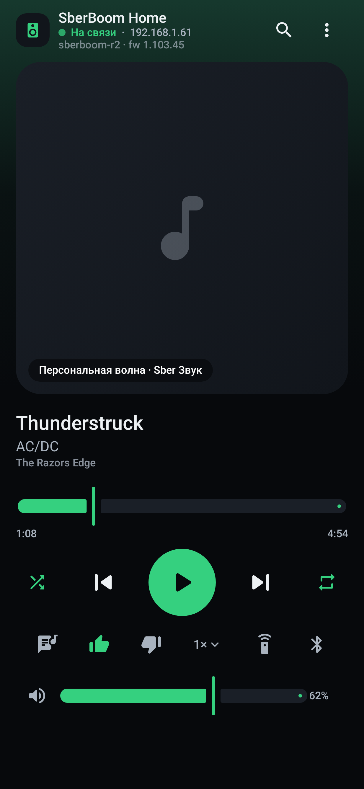
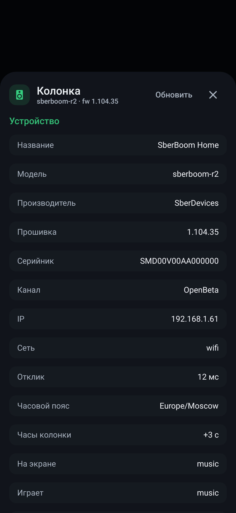

# SberBoom Remote

Полностью локальное управление умной колонкой **SberBoom** — с Android-телефона и из
Windows. Без Home Assistant, облака, аккаунта Сбера и токенов разработчика.

Связь идёт напрямую по Wi-Fi: `wss://<ip-колонки>:20000`, протокол StarOS.
Авторизация — однократное нажатие кнопки **«+»** на корпусе колонки; полученный
PIN-токен сохраняется локально.

| Версия | Сборка | Готовый файл |
|---|---|---|
| Android | `SberBoomRemote/` (Gradle + AGP 9 + Compose) | `app-debug.apk` |
| Windows | `SberBoomWinUI3/` (WinUI 3, C#/.NET 9) — версия 1.3.1 | `SberBoomRemote.exe`, zip без установки |
| Windows (прежняя) | `SberBoomDesktop/` (Compose Desktop) | `SberBoom Remote.exe`, MSI-установщик — остаётся в репозитории до 1.4 |

<p align="center">
  
  
  
</p>

## Возможности

- **Плеер**: обложка, название/исполнитель/альбом, позиция и длительность,
  play/pause, next/prev, seek, громкость, mute, shuffle, repeat, лайк/дизлайк,
  скорость 0.5×–2.0×, «найти пульт»
- **Ambient-цвет** интерфейса из обложки (как LED-кольцо колонки)
- **Каталог Sber Звука**: поиск (исполнители/альбомы/треки/плейлисты),
  drill-down артист → альбом → трек, запуск воспроизведения на колонке
- **Очередь** (`op=17`) с обогащением метаданными каталога
- **Караоке**: синхронный текст (Lrclib → NetEase), посимвольная заливка,
  работает и для Bluetooth/радио
- **Bluetooth-панель**: спаренные устройства, подключить/отключить/забыть,
  режим сопряжения; для BT-источника — текущий трек и похожие
- **Панель «Колонка»**: модель, производитель, прошивка и серийник из `op=10`,
  задержка связи по эхо `op=8`, будильники, таймеры, напоминания, LED, профиль,
  стереопара, multiroom, SberCast, сеть, часовой пояс, рассинхрон часов
- **Медиа-уведомление и плитка в шторке** (Android): обложка, транспорт,
  управление без открытия приложения
- **Трей и горячие клавиши** (Windows): окно в трее, `Ctrl+Space`, `Ctrl+←/→`, медиа-клавиши
- **Таймер сна**: остановка через 15/30/60/90 минут
- **«Недавнее»**: история до 40 треков с обложками
- **Диагностика**: адрес, модель/прошивка/серийник, задержка, отчёт в буфер обмена
- **Несколько колонок**: свой PIN-токен на каждую, переключение в один тап
- **Push-обновления** вместо поллинга; оптимистичные команды громкости/паузы

## Архитектура

Приложение собрано один раз и работает в двух сборках:

```
├── shared/                  общий слой (без платформенного кода)
│   └── src/main/java/ru/sberboom/remote/
│       ├── protocol/        TLV-кодек, конверт, команды, парсеры op=10/12/17/19
│       ├── net/             SpeakerClient (WSS), ZvukApi, LyricsApi
│       ├── data/            PlayerRepository — оркестратор состояния
│       └── platform/        Settings / DiscoveryService / CoverService (интерфейсы)
├── SberBoomRemote/          Android-приложение (модуль :shared)
└── SberBoomDesktop/         Windows-приложение (shared как srcDir)
```

Платформенные реализации — ровно три:

| Интерфейс | Android | Windows |
|---|---|---|
| `Settings` | SharedPreferences | `java.util.prefs` |
| `DiscoveryService` | `NsdManager` + TCP-скан | JmDNS + TCP-скан `/24` |
| `CoverService` | `BitmapFactory` + `android.graphics.Color` | `ImageIO` + `java.awt.Color` |

## Сборка

### Android

```bash
cd SberBoomRemote
./gradlew :app:assembleDebug
# APK: app/build/outputs/apk/debug/app-debug.apk
```

Тесты (протокол + парсеры + рендеры экранов через Robolectric):

```bash
./gradlew :app:testDebugUnitTest
```

### Windows

```bash
cd SberBoomDesktop
./gradlew run                  # запуск из исходников
./gradlew createDistributable  # приложение с JVM: build/compose/binaries/main/app
```

`createDistributable` нужен полный JDK с `jpackage.exe` (JBR из Android Studio —
урезанный JRE): положите JDK в `../tools/jdk21` или задайте `SB_JDK`.

## Ветка `material-3-expressive`

Редизайн интерфейса в стилистике **Material 3 Expressive**. Живёт в отдельной ветке,
`main` остаётся на прежнем оформлении — сравнить можно, переключив ветку.

Что изменилось в оформлении:

- **Палитра** — полный набор контейнерных ролей M3 (`surfaceContainerLowest…Highest`,
  `secondaryContainer`, `tertiary`, `inverseSurface`): карточки и чипы теперь отделяются
  от фона цветом, а не обводкой. Светлая тема пересчитана под тот же набор.
- **Типографика** — Expressive-шкала: `displayLarge 48`, `displayMedium 40`,
  `displaySmall 34`, заголовки жирнее и с отрицательным трекингом.
- **Форма** — крупные радиусы (extraLarge 36 dp), кнопки-пилюли и «сквориклы».
- **Движение** — пружины вместо линейных переходов: нажатие «продавливает» элемент
  и возвращается с перелётом (`Modifier.pressScale`), экраны меняются через
  `AnimatedContent` со scale+fade.
- **Волнистый прогресс** — `WavyProgress`: по прошедшей части трека бежит синусоида,
  амплитуда дышит, на паузе волна схлопывается в линию; тап и перетаскивание — перемотка.
  Сделано на Canvas, потому что библиотечный `LinearWavyProgressIndicator` есть не на всех
  платформах, а этот код общий для Android и Windows.
- **Чипы-переключатели** — `ExpressiveChip`: shuffle, повтор, лайк, текст, скорость,
  пульт, Bluetooth; выбранное состояние заливается `primaryContainer`.
- **Транспорт** — плавающая пилюля `surfaceContainerHigh` с крупной кнопкой-сквориклом.

Собрать обе версии из ветки:

```bash
git checkout material-3-expressive

cd SberBoomRemote && ./gradlew :app:testDebugUnitTest :app:assembleDebug
cd ../SberBoomDesktop && python tools/sync-ui.py && ./gradlew createDistributable
```

`Expressive.kt` (общий для платформ) содержит `pressScale`, `ExpressiveChip`,
`WavyProgress`, `ExpressiveSection`; пружины и кривые — в `Theme.kt` (`object Motion`).

## Протокол

Всё, что известно про порт 20000 и StarOS, собрано в
[docs](SberBoomRemote/docs/PROTOCOL-NOTES.md): op-коды и статусы, структура
`GET_STATE`/`GET_METADATA`, поведение сопряжения (отзыв токена при повторном
`PAIR_INIT`), результаты фаззинга тел запросов, разбор официального
companion-приложения — [APK-RESEARCH.md](SberBoomRemote/docs/APK-RESEARCH.md).

## Ограничения

- Только локальная сеть: извне колонка недоступна.
- Эквалайзер, яркость кольца, мультирум и офлайн-треки живут в облаке Сбера —
  в локальном протоколе их нет (проверено фаззингом `op=24…64`).
- PIN-токен действует до следующего сопряжения; при отзыве приложение само
  попросит нажать «+» заново.

## Лицензия и атрибуция

MIT, см. [LICENSE](LICENSE).

Протокол портирован из Home Assistant-интеграции
[sboom_ha](https://github.com/TohaRG2/sboom_ha) (MIT): TLV-конверт, op-коды,
парсеры состояния. Спасибо автору.

Проект **не аффилирован** с ПАО Сбербанк, SberDevices и их дочерними структурами,
не обходит технические средства защиты и работает только с колонками, которыми
владеет сам пользователь (сопряжение требует физического нажатия «+»).
Предоставляется AS-IS: обновление прошивки колонки может сломать совместимость.
