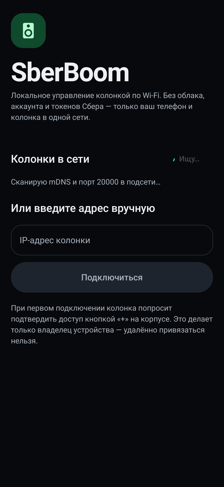

# SberBoom Remote — Android-пульт для колонок SberBoom

Полностью локальное управление умной колонкой SberBoom с Android-телефона:
плеер, громкость, лайки, скорость, поиск по каталогу Sber Звук — без облака,
аккаунта Сбера и токенов разработчика. Связь идёт напрямую по Wi-Fi
(`wss://<ip>:20000`), авторизация — однократным нажатием кнопки **«+»** на корпусе
колонки.

Приложение — самостоятельный Android-клиент протокола StarOS, портированного из
Home Assistant-интеграции [sboom_ha](https://github.com/TohaRG2/sboom_ha)
(MIT). Home Assistant для работы **не нужен**.

## Две версии, один код

| Версия | Где | Сборка |
|---|---|---|
| Android (APK) | `SberBoomRemote/` | `./gradlew :app:assembleDebug` |
| Windows (exe) | `SberBoomDesktop/` | `./gradlew createDistributable` |

Общий слой — модуль `../shared`: TLV-кодек, конверт, команды, парсеры `op=10/12/17/19`,
WSS-клиент `SpeakerClient`, каталог Sber Звука `ZvukApi`, лирика `LyricsApi`.
Android подключает его как Gradle-модуль `:shared`, Windows — как дополнительный
`srcDir`; платформа даёт только три реализации: `Settings`, `DiscoveryService`,
`CoverService`. Подробности — в `../SberBoomDesktop/README.md`.

## Возможности

**Плеер**
- Обложка, название, исполнитель, альбом, контекст («Персональная волна · Sber Звук»)
- Play / Pause, Next / Previous, перемотка по позиции трека
- Громкость и mute (оптимистичные обновления — UI реагирует мгновенно)
- Shuffle, повтор (off / плейлист / трек), лайк / дизлайк
- Скорость воспроизведения 0.5×–2.0×
- «Найти пульт», режим Bluetooth-сопряжения колонки
- **Караоке / текст песни**: синхронизированные строки из Lrclib (резерв — NetEase),
  автопрокрутка, подсветка текущей строки и **посимвольная заливка** пропетого
  (включается/выключается в караоке); работает и для Bluetooth/радио,
  где нет каталожного id (поиск по исполнителю+названию)
- **Строка текста в плеере** — текущая строка под названием трека, тап открывает караоке
- **Каталог с drill-down**: страница артиста (популярные треки + дискография) и
  альбома (треклист), «Играть артиста/альбом» одним нажатием
- **Панель «Колонка»** из GET_STATE: будильники (время и дни), таймеры, напоминания,
  яркость/LED-кольцо, автогромкость, профиль и детский режим, стереопара/multiroom,
  SberCast, сеть, часовой пояс, расхождение часов, геолокация — только чтение
- **Медиа-уведомление и экран блокировки**: обложка, название, транспорт
  (play/pause, next/prev) — управление колонкой без открытия приложения
- **Плитка в шторке** быстрых настроек: состояние и пауза одним тапом
- **Таймер сна**: остановить колонку через 15/30/60/90 минут
- **Недавнее**: до 40 последних треков с обложками, тап — снова играть
- **Диагностика связи**: адрес, модель/прошивка/серийник, задержка, последняя
  ошибка, кнопка «Скопировать отчёт»
- **Автоподключение при возврате в Wi-Fi** (вышли из VPN, переключились с мобильной сети)
- **Несколько колонок**: сохранённые устройства со своим токеном на каждое,
  переключение в один тап
- **Очередь / «что дальше»**: реальная очередь колонки (op=17) с обложками из каталога,
  текущий трек подсвечен, тап — включить трек. Открывается тапом по обложке
- **Bluetooth-режим панели**: если источник — Bluetooth, очередь недоступна (её знает
  только телефон), вместо неё показывается подключённое устройство и похожие треки Звука
- **Bluetooth-панель**: список спаренных устройств колонки (op=19), «подключить / отключить / забыть»
  (op=20), запуск режима сопряжения. Выключить сам BT-модуль протокол колонки не умеет —
  модулем управляет прошивка (таймаут, голос, смена источника)
- Ambient-свечение: фон окрашивается в цвет текущей обложки, как LED-кольцо колонки
- Push-обновления от колонки: смена трека приходит сама, без поллинга

**Поиск и запуск контента**
- Поиск по каталогу Sber Звук: исполнители, альбомы, треки, плейлисты (с обложками)
- Тап по результату — трек/артист/альбом/плейлист заиграет на колонке
  (`staros://music` deeplink через ServerAction)
- Вставка ссылки `zvuk.com/track/84279897` — запуск по ней

**Подключение**
- Автопоиск: mDNS (`_staros._tcp`) + TCP-скан порта 20000 по подсети
  (работает даже при клиентской изоляции Wi-Fi, где multicast не проходит)
- Модель и версия прошивки из mDNS TXT (`type`, `v`) — видно в списке колонок и в шапке плеера
- Ручной ввод IP
- Один экран сопряжения: нажать «+» на колонке — токен сохраняется на телефоне
- Автопереподключение с backoff, статус связи в шапке

## Скриншоты

| Плеер | Подключение | Поиск |
|---|---|---|
|  |  |  |


## Ветка `material-3-expressive`

Редизайн интерфейса в стилистике **Material 3 Expressive**. Живёт в отдельной ветке,
`main` остаётся на прежнем оформлении — сравнить можно, переключив ветку.

Что изменилось в оформлении:

- **Палитра** — полный набор контейнерных ролей M3 (`surfaceContainerLowest…Highest`,
  `secondaryContainer`, `tertiary`, `inverseSurface`): карточки и чипы теперь отделяются
  от фона цветом, а не обводкой. Светлая тема пересчитана под тот же набор.
- **Типографика** — Expressive-шкала: `displayLarge 48`, `displayMedium 40`,
  `displaySmall 34`, заголовки жирнее и с отрицательным трекингом.
- **Форма** — крупные радиусы (extraLarge 36 dp), кнопки-пилюли и «сквориклы».
- **Движение** — пружины вместо линейных переходов: нажатие «продавливает» элемент
  и возвращается с перелётом (`Modifier.pressScale`), экраны меняются через
  `AnimatedContent` со scale+fade.
- **Волнистый прогресс** — `WavyProgress`: по прошедшей части трека бежит синусоида,
  амплитуда дышит, на паузе волна схлопывается в линию; тап и перетаскивание — перемотка.
  Сделано на Canvas, потому что библиотечный `LinearWavyProgressIndicator` есть не на всех
  платформах, а этот код общий для Android и Windows.
- **Чипы-переключатели** — `ExpressiveChip`: shuffle, повтор, лайк, текст, скорость,
  пульт, Bluetooth; выбранное состояние заливается `primaryContainer`.
- **Транспорт** — плавающая пилюля `surfaceContainerHigh` с крупной кнопкой-сквориклом.

Собрать обе версии из ветки:

```bash
git checkout material-3-expressive

cd SberBoomRemote && ./gradlew :app:testDebugUnitTest :app:assembleDebug
cd ../SberBoomDesktop && python tools/sync-ui.py && ./gradlew createDistributable
```

`Expressive.kt` (общий для платформ) содержит `pressScale`, `ExpressiveChip`,
`WavyProgress`, `ExpressiveSection`; пружины и кривые — в `Theme.kt` (`object Motion`).

## Сборка

Нужны JDK 17+ и Android SDK (platform 37, build-tools 36).

```bash
cd SberBoomRemote
echo "sdk.dir=/path/to/Android/Sdk" > local.properties
./gradlew :app:assembleDebug
# APK: app/build/outputs/apk/debug/app-debug.apk
```

Установка на телефон (USB-отладка):

```bash
adb install -r app/build/outputs/apk/debug/app-debug.apk
```

Минимальная версия Android — 8.0 (API 26).

## Первое подключение

1. Телефон и колонка — в одной Wi-Fi сети.
2. Открыть приложение → «Найти» (или ввести IP колонки вручную).
3. Нажать на найденную колонку.
4. Колонка попросит подтвердить доступ: **нажать «+»** на её корпусе
   (там, где обычно показывается громкость).
5. Готово: приложение запомнит токен и будет подключаться само.

## Как это работает

Протокол StarOS: TLS WebSocket на порту 20000, бинарные кадры в
Google-proto-wire кодировке (varint + length-delimited), JSON внутри
length-delimited полей.

Подробные замеры на живой колонке (все op-коды, статусы, реквизиты устройства,
поведение сопряжения) — в [docs/PROTOCOL-NOTES.md](docs/PROTOCOL-NOTES.md).

```
envelope: field(1,0,2)=type, field(2,2)=msg_id, field(3,2)=pin_token,
          field(5,2)=request_data, field(6,0,1)=token_type,
          field(7,2)=client_name, field(10,0,1), field(11,2)=client_id

request_data: field(op, 2, ...)   op=4 пара, 10 метаданные, 12 состояние,
                                  14 громкость, 15 seek, 16 медиа-команда,
                                  17 очередь, 18 keep-alive, 19–22 Bluetooth,
                                  23 скорость

media action (внутри op=16): 0 mute, 1 unmute, 2 next, 3 prev, 4 play,
                              5 pause, 6 like, 7 remove_like, 9/10 shuffle,
                              11/12/13 repeat, 14 dislike, 15 remove_dislike
```

Сопряжение: `op=4` с пустым запросом → колонка озвучивает просьбу нажать «+» →
после нажатия присылает `field(6)` со статусом OK и PIN-токеном в `field(2)`.

Корректность порта проверяется байт-в-байт: `tools/gen_fixtures.py` собирает
эталонные кадры Python-кодом интеграции sboom_ha, а JVM-тесты сравнивают с ними
кадры Kotlin-кодека (`ProtocolTest`).

```
app/src/main/java/ru/sberboom/remote/
├── protocol/   Tlv (кодек), Envelope (конверты), Payloads (парсеры), Proto (константы)
├── net/        SpeakerClient (WS+pair), ZvukApi (каталог), Discovery (mDNS+скан), CoverArt
├── data/       PlayerRepository (состояние, команды, переподключение), Prefs
└── ui/         Compose: PlayerScreen, ConnectScreen, SearchScreen, Root, Theme
```

## Тесты

```bash
./gradlew :app:testDebugUnitTest
```

- `ProtocolTest` — байт-в-байт сверка кадров с Python-эталонами, разбор реального
  захвата метаданных трека, парсинг state (радио, Bluetooth, битый JSON), deeplink.
- `ScreenRenderTest` — рендер экранов в Robolectric (native graphics) с сохранением PNG
  в `app/build/screenshots`.

## Ограничения

- Нужна одна L2-сеть: телефон и колонка в одном Wi-Fi. Через интернет протокол не работает.
- Громкость ограничена прошивкой колонки (наблюдаемый потолок ~75%).
- Радио не отдаёт позицию трека — перемотка доступна только для каталога.
- Протокол неофициальный: SberDevices может изменить его в новой прошивке.
- Приложение не аффилировано с ПАО Сбербанк / SberDevices; работает только с
  колонками, которыми владеет пользователь, и не обходит технические средства защиты.

## Совместимость моделей

- **SberBoom Home / R2** — основной целевой сценарий (всё, что умеет `sboom_ha`).
- **SberBoom Mini (SBDV-00095)** — тот же локальный WSS `:20000`, физическое
  сопряжение и `GET_STATE` подтверждены независимым исследованием
  [sberboom-mini-research](https://github.com/ryysel/sberboom-mini-research).
- На Mini закрыты порты 22/23/4242/5555, поэтому Zigbee/Matter-инвентарь (`:4242`)
  и датчики платы через libiio (`:30431`), которые есть в HA-интеграции, в
  приложении не реализуются — на этой модели их просто нет.
- «Rabbit Hole» (UART/ADB, JWT RS256 в `staros/box`) — отдельная подсистема
  загрузчика и служебного ADB, к локальному API плеера отношения не имеет.

## Лицензия и атрибуция

MIT. Протокол и разбор payload'ов — по исследованиям
[sboom_ha](https://github.com/TohaRG2/sboom_ha) (MIT), там же подробный
`research/PROTOCOL.md`. Каталог и обложки — публичный анонимный API zvuk.com;
обложки для радио/Bluetooth — iTunes Search API и Deezer (без ключей).
