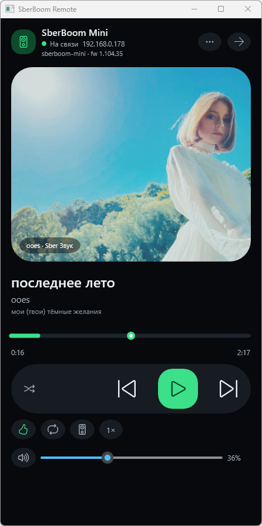

# SberBoom Remote для Windows — WinUI 3

Windows-версия пульта SberBoom на **WinUI 3** (Windows App SDK 1.7, .NET 9, C#).
Версия **1.3.1**. Пришла на смену Compose Desktop-сборке: тот же локальный протокол
(`wss://<ip>:20000`), но нативное окно, нативные контролы и системная тема Windows.



## Что умеет

- **Подключение** — поиск колонок (mDNS `_staros._tcp` + TCP-скан подсети по порту 20000),
  ручной ввод адреса, сохранённые колонки, автоподключение при запуске.
- **Сопряжение** — PIN-токен: приложение просит нажать «+» на корпусе колонки
  (`op=4` → ответ `WAITING` → нажатие → `op=6` с токеном). Токен хранится по хосту
  и удаляется, если колонка его отозвала.
- **Плеер** — обложка из Звука, название/исполнитель/альбом, волнистый прогресс
  с перемоткой по тапу и перетаскиванию, транспорт (play/pause, вперёд/назад),
  случайный порядок, повтор (нет/плейлист/трек), лайк, скорость, громкость и mute.
- **Состояние колонки** — модель, прошивка, адрес, сеть, громкость, подсветка,
  яркость LED, число будильников, текущий трек и источник (`op=12`).
- **Тема** — светлая и тёмная, выбор сохраняется в настройках.

## Чего пока нет

Перенесены не все возможности Android-версии: нет каталога и поиска в Звуке,
текстов песен (LRC), экрана очереди (`op=17` отдаёт только `trackId`, названия
тянутся из каталога Звука), панели Bluetooth и Яндекс Музыки. Протокольный слой
для них уже есть (`Requests`, `MessageTypes`), не хватает UI.

## Сборка

Нужен **.NET SDK 9** (в репозитории — `tools/dotnet`, ставится скриптом
`dotnet-install.ps1 -Channel 9.0`) и **Windows App Runtime 1.7** (обычно уже
установлен на Windows 11; если нет — [установщик](https://aka.ms/windowsappsdk/1.7/latest/windowsappruntimeinstall-x64.exe)).

```bash
cd SberBoomWinUI3
dotnet build -c Release          # bin/Release/net9.0-windows10.0.26100.0/SberBoomRemote.exe
dotnet publish -c Release -o dist
cp bin/Release/net9.0-windows10.0.26100.0/*.xbf dist/   # XBF не копируются публикацией
```

### Почему так, а не «как в Visual Studio»

Здесь нет Visual Studio, поэтому сборка идёт обычным `dotnet build`. Windows App SDK
тянет две группы MSBuild-задач, которые поставляются только с VS/UWP-workload
(`Microsoft.Build.AppxPackage.dll`, `Microsoft.Build.Packaging.Pri.Tasks.dll`).
Для распакованного (unpackaged) приложения PRI-индексация и AppX-упаковка не нужны,
поэтому в `tools/msbuild-shims` лежат тождественные заглушки этих задач, а в
проекте они подключены через `AppxMSBuildTaskAssembly` / `PriProjTaskAssembly`.

Инициализация Windows App SDK тоже ручная: в `Program.cs` вызывается
`Bootstrap.TryInitialize(0x00010007, null, default, out hr)` — автоинициализатор
из NuGet-таргетов при выключенном MSIX-тулинге не подключается.

## Устройство

| Путь | Что внутри |
|---|---|
| `Protocol/Tlv.cs` | TLV-кодек (proto-wire без схемы), байт-в-байт как в интеграции HA |
| `Protocol/Proto.cs`, `Requests.cs` | опкоды, тела запросов, сборка конвертов |
| `Protocol/StateParser.cs` | разбор JSON состояния `op=12` (активный плеер из `background_apps`) |
| `Net/SpeakerClient.cs` | WebSocket-клиент: самоподписанный сертификат, ответы по `msg_id`, push-сопряжение |
| `Net/Discovery.cs` | mDNS-запрос и TCP-скан подсети |
| `Controls/WavyProgress.cs` | волнистый прогресс (синусоида, амплитуда, перемотка) |
| `Data/Settings.cs` | `%APPDATA%\SberBoomRemote\settings.json` |
| `SberBoomWinUI3.ProtocolTests/` | консольная проверка протокола на живой колонке |

Живая проверка протокола без UI:

```bash
cd SberBoomWinUI3.ProtocolTests
dotnet run -- 192.168.0.178 <pin-токен>
```

## Ограничения

- Эквалайзер, яркость кольца, мультирум и офлайн-треки — только через облако Сбера.
- PIN-токен живёт до следующего сопряжения: колонка выдаёт его на одну сессию
  и отзывает при любом новом сопряжении.
- Токен привязан к имени клиента: приложение представляется как «SberBoom Remote»
  (как и Android-версия), иначе колонка отвечает статусом 4.

MIT. Протокол портирован из [sboom_ha](https://github.com/TohaRG2/sboom_ha) (MIT).
Проект не аффилирован с ПАО Сбербанк / SberDevices.
